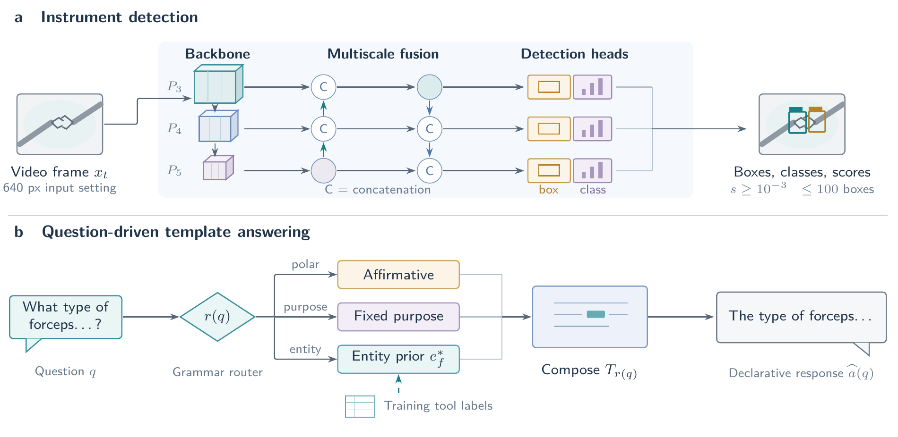

# SurgVU 2026 · AIMS Lab

[Method report](paper/SurgVU_Report_AIMS.pdf) · [LaTeX source](paper/SurgVU_Report_AIMS.tex) · [Vector figure](paper/fig_method.pdf)

**Omar Choudhry**

Artificial Intelligence in Medicine and Surgery Group, School of Computer Science, University of Leeds, UK

[O.Choudhry@leeds.ac.uk](mailto:O.Choudhry@leeds.ac.uk) · [ORCID 0000-0003-4434-3550](https://orcid.org/0000-0003-4434-3550)

Our [SurgVU 2026](https://surgvu26.grand-challenge.org/) entry uses two independent systems. Category 1 detects instruments in each frame with a YOLO26 model trained on human boxes and presence-filtered pseudo-labels. Category 2 generates short declarative answers from the question and training-label instrument frequencies, without reading the video.



## Category 1

The detector uses the medium YOLO26 configuration initialised from pretrained weights. Human COCO annotations define the localisation target. The local split uses videos 1–5 for training and videos 6–7 for validation.

For additional supervision, a detector proposes boxes on training frames. The `FILTER` rule keeps a proposal only if its confidence is at least 0.25 and its class appears in the installed-tool set for that frame. For proposal detector $f_\phi$ and installed-tool set $I_t$,

$$
\widetilde{\mathcal D}_t = \{(b,c)\mid (b,c,s)\in f_\phi(x_t),\ s\geq0.25,\ c\in I_t\}.
$$

The proposer excludes the held-out videos and uses its last checkpoint. Retained pseudo-labels are combined with human-labelled training frames. Training uses seeds 0, 1 and 2. The seed-2 checkpoint was selected by local validation mAP for submission. Installation labels constrain the proposed class but do not establish visibility.

Inference processes every decoded frame independently with one checkpoint, an input-size setting of 640 pixels, confidence threshold 0.001 and at most 100 detections per frame. Each output contains four box corners in original frame coordinates, the instrument class, confidence and frame index. There is no temporal smoothing.

## Category 2

A deterministic router selects one of three grammatical branches.

| Question form | Slot policy |
| --- | --- |
| Leading auxiliary, such as “is” or “was” | Affirmative polarity |
| Contains “purpose” or begins with “why” | Fixed phrase “to grasp and hold tissue” |
| Other questions | Entity prior or a fixed fallback |

The selected template reuses the question's wording in declarative order. Sentence length is variable.

The entity prior comes from `tools.csv` installation intervals overlapping deduplicated `tasks.csv` segments across 155 training cases. The archived prior contains 1,850 segments. Each segment contributes once to the count for each installed commercial tool name. Within instrument family $f$, the selected name is

$$
e_f^*=\underset{u\in\mathcal V_f}{\arg\max}\;\frac{1}{N}\sum_{j=1}^{N}\mathbf 1\{u\in S_j\},
$$

where $S_j$ is the installed-tool set for segment $j$. The longest matching family name in the question selects the lookup. Organ and procedure questions use fixed phrases. Unmatched entity questions fall back to “the tissue”. The optional visual task classifier is disabled in the submitted answer policy.

The active answerer loads no neural model and opens no video. Its fixed affirmative policy and entity prior cannot verify events in an unseen clip.

## Evaluation

Category 2 is ranked by BERTScore-F1 using `roberta-large` with baseline rescaling. The evaluator takes the maximum over reference answers for each question, then averages across questions. The diagnostic scripts probe constant answers, polarity and sentence length on 11 public examples. These small-set probes do not establish visual understanding.

The report gives the method equations and relevant limitations. This repository does not redistribute challenge data or trained detector weights.

## Files and report build

```text
experiments/    training, pseudo-label generation, scoring and ablations
our_scripts/    submission-side inference helpers
paper/          report PDF, LaTeX, BibTeX and editable figure sources
```

Build the report with a standard TeX Live or MacTeX installation. The figure uses TikZ and the `standalone` class.

```sh
cd paper
latexmk -pdf -interaction=nonstopmode -halt-on-error fig_method.tex
latexmk -pdf -interaction=nonstopmode -halt-on-error SurgVU_Report_AIMS.tex
```

SLURM scripts contain cluster-specific paths with the account name replaced by `USERNAME`. The report build is separate from model training and evaluation.

## References

1. Glenn Jocher, Jing Qiu, Mengyu Liu, Shuai Lyu, Fatih Cagatay Akyon and Muhammet Esat Kalfaoglu. [Ultralytics YOLO26: Unified Real-Time End-to-End Vision Models](https://arxiv.org/abs/2606.03748). 2026.
2. Ramprasaath R. Selvaraju, Michael Cogswell, Abhishek Das, Ramakrishna Vedantam, Devi Parikh and Dhruv Batra. [Grad-CAM: Visual Explanations from Deep Networks via Gradient-Based Localization](https://doi.org/10.1109/ICCV.2017.74). ICCV, pages 618–626, 2017.
3. Tianyi Zhang, Varsha Kishore, Felix Wu, Kilian Q. Weinberger and Yoav Artzi. [BERTScore: Evaluating Text Generation with BERT](https://openreview.net/forum?id=SkeHuCVFDr). ICLR, 2020.

## Licence and funding

Code is available under the [MIT licence](LICENSE). Challenge data and third-party software remain subject to their own terms. Funded by UKRI EPSRC grant EP/S024336/1.
